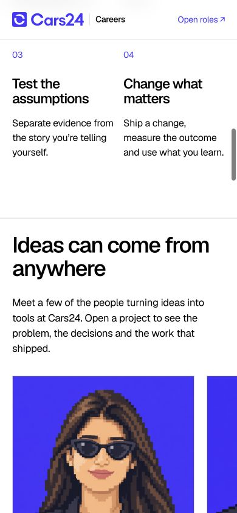
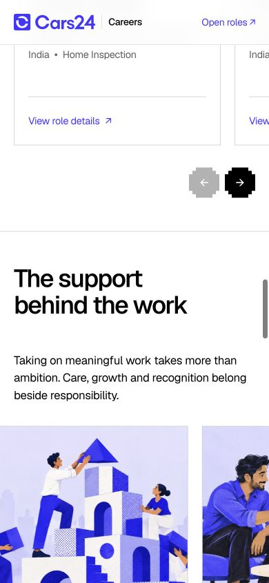
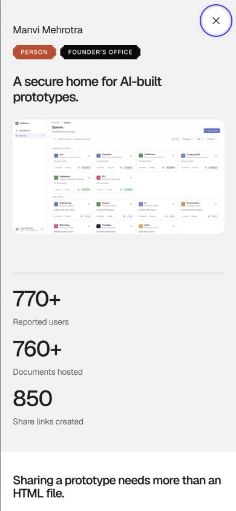
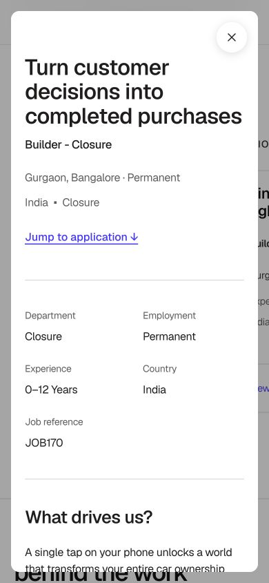
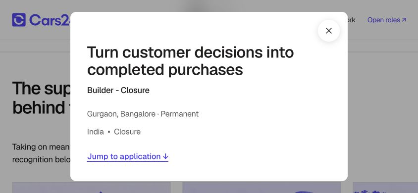

# Visual UAT review · 15 November 2026

## Result

**Cleared for the next release step within the tested coverage.** Three visual/accessibility findings were fixed and rechecked. No material visual blocker remains in the local revision reviewed after those fixes. This is a bounded browser audit, not a claim of flawless behaviour on every physical device.

The review combined frontend layout checks, interaction testing and designer judgement. Typography retains Geist throughout normal UI, with the authored handwritten letter and signature as intentional exceptions. The sticker palette, distinct silhouettes and native whole-card motion are retained. Section headings, body copy and card controls now have consistent, readable roles.

## Coverage and evidence

Browser: authenticated Chrome through computer-use tooling. The child-agent environment did not expose the in-app browser, so a dedicated Chrome tab was used. No product source was edited by this reviewer.

Home and `/careers/` were measured at **320, 375, 390, 414, 768, 834, 1024, 1280 and 1440 CSS pixels**, generally at 900px height. The actual `innerWidth` was checked at each step; this matters because the viewport capability affects the selected tab. Additional visual mobile checks used 390×844, and the short-height landscape check used **844×390**.

- Home document width matched viewport width at all nine sizes. There was no horizontal page overflow, including after the fixes.
- The listing retained all seven current openings and had no horizontal page overflow at all nine sizes.
- A nonexistent search produced the real empty state. Clear filters restored the seven openings.
- Support details opened with full-width mobile layout, image and copy intact. Tab remained inside the native modal. Escape closed it and restored focus to the triggering programme card.
- Manvi’s builder story opened from keyboard activation. Its image, reported metrics, sections and project navigation were readable in the mobile drawer.
- Closure’s role details loaded the actual published description, locations, experience and current application state. No application was submitted. The role modal fit 844×390 with an accessible 44px close control and an internal scroll area.
- Sticker pause set the animation state to `paused`; resume restored the normal visibility/device-budget policy.
- Builder reveal showed twelve stories; collapse restored four. The original stories remain available.
- At normal reading positions, after-fix builder/support/letter headings stayed whole rather than separating individual characters.

Machine-readable evidence: `screenshots/layout-matrix.json`, `listing-matrix.json` and `after-fix-matrix.json`. Full-page screenshots captured near initial navigation can contain animation or lazy-image intermediate states; use the settled section screenshots below as the visual evidence, not transient pixels in those early captures.

## Findings and recheck

| Priority | Finding | Evidence and source | Resolution |
| --- | --- | --- | --- |
| P2 | Random per-character roll made builder and support headings appear broken at a normal mobile reading position. The lettering did not need to overflow the page to become hard to read. | Initial `screenshots/mobile-builders.jpg` and `mobile-support.jpg`; builder/support section H2s, retained heading-roll runtime. | Added `data-no-roll` to builder, support and letter editorial H2s. Rechecked all nine widths: those headings remain unsplit. Settled evidence: `mobile-builders-fixed.jpg`, `mobile-support-fixed.jpg`. |
| P2 | Mobile logo home link was 35px high, below the intended 44px target. | Initial DOM geometry at 320–414px; `.navbar-v2__home`. | The anchor now measures 44px high at every checked width. It fits the header without adding page overflow. |
| P2 | Meaningful footer legal/copyright text was 10px on mobile, smaller than the page’s other captions. | Initial computed type; `src/styles.css` mobile `.society-legal` treatment. | UAT override raises legal text to 12px. Rechecked 320–1440px; computed size is 12px throughout. |

The UX-copy reviewer separately identified the real CTA inconsistencies: listing navigation routing back to the home anchor, a card action promising application where submission may be unavailable, and role links whose accessible names omitted the problem. The final local DOM now uses the revised role-details action and a problem-plus-role accessible name. Repeated role entry points in the header, hero, openings and final section are intentional journey entry points; they were not removed merely for repetition.

## Settled visual samples

## Production-branch verification

Read-only verification in the existing authenticated Vercel project:

- Git settings showed connected repository `ishaankothiyal-designer/c24-careers`.
- At `https://vercel.com/design-ea38/c24-careers/settings/environments/production`, **Branch Tracking** explicitly said: “Every commit pushed to the main branch will create a Production Deployment.”
- The matching-pattern field showed **main**.
- Automatic assignment of custom production domains was enabled.
- The Production Domains section listed **c24-careers-chi.vercel.app**.

No project settings were changed. No credential values were revealed and no account/settings screenshots were saved in this evidence set.

## Limits and remaining source dependencies

This pass uses Chrome viewport simulation and desktop input. It does not replace physical Android/iPhone scrolling and frame-time measurement, nor separate Safari/Firefox testing. Reduced-motion/constrained-device policies are implemented and covered by the project’s behavioural checks; no OS accessibility setting was changed during this review. Live API loading was observed, but no applicant upload or real submission was performed.

The broader approved builder roster, role-specific decision scope/first-90-day outcomes and canonical numerical company ambition remain content-owner dependencies described in the brief report. The current required-location application restriction is existing backend behaviour, not a new visual regression. The separate About project remains outside this Careers release.

Browser ownership was released after local recheck. A production route smoke pass should follow the successful deployment.
